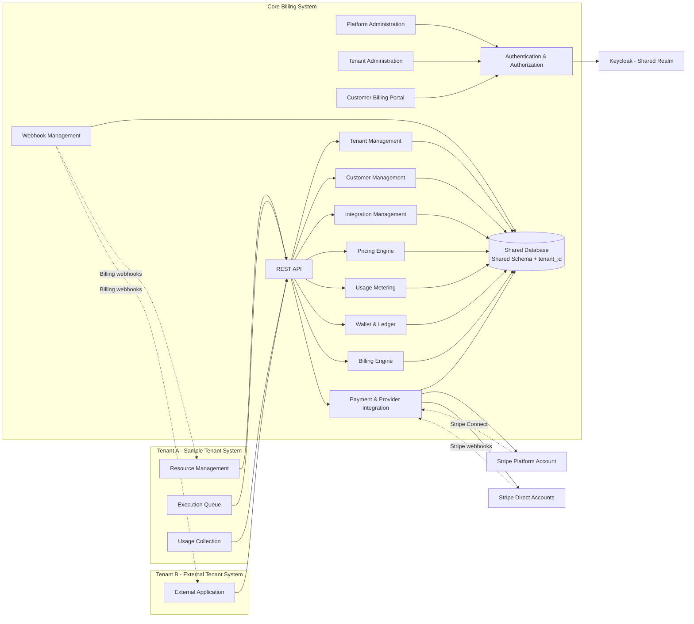

# Architecture

## System diagram

The Stripe Platform Account serves Connect. A Tenant's Stripe accounts are either linked through Connect or integrated directly. See [payments-and-stripe.md](payments-and-stripe.md).

## Decision ledger

| Area | Decision | Why |
|---|---|---|
| Deployment shape | Two independently deployable systems that talk only through REST API, Events and Webhooks | Billing must serve any Tenant System, and the sample must prove that |
| Backend | Java with Spring Boot, DDD and Clean Architecture, built as a Gradle multi-module project; used for both Billing and the Sample Tenant System | Chosen by the project owner |
| Backend shape | Modular monolith per system, with Gradle modules as bounded-context boundaries | Wallet, Ledger and the outbox must change in one ACID transaction on one database |
| Backend layering | A bounded context is a Gradle module with `api`, `domain`, `application` and `adapter` source sets; inside a layer, packages are grouped by feature and then by role (`command`, `query`, `port`, `adapter/persistence/<feature>`), and no class sits in a layer-root package | Keeps the module boundary above the framework, gives every package one job, and lets the build enforce the shape |
| Inner layers | `domain` and `application` are plain Java: no Spring, JPA or Jackson; persistence types stay in the adapter | Business rules stay independent of the framework, and the rule can be enforced mechanically |
| Persistence | Spring Data JDBC. Each aggregate is written through a package-private `@Table` Row with `from`/`toDomain` next to its write repository; plain inserts, whole-row updates and by-id reads use `JdbcAggregateOperations`. Persistent SQL that encodes a rule stays explicit `JdbcClient`: locks, guarded or partial updates, append-only ledger inserts, conflict-ignoring inserts and upserts. Reads select into immutable views through `Jdbc*ReadRepository`. | Matches aggregate-per-transaction, avoids a persistence context and keeps a result set from flowing into a domain type |
| Transaction boundary | An application-owned `UnitOfWork` port that use cases wrap themselves; the Spring implementation lives in infrastructure | Money keeps one ACID transaction while the application layer never sees `@Transactional` |
| Cross-context calls | Synchronous in-process only on the money path, through each context's public `api` package; other flows use domain events through the outbox | Money needs one transaction; the rest can stay decoupled without weakening the ledger |
| Boundary enforcement | Gradle classpath rules first, then ArchUnit and Spring Modulith in the build. Each module declares `api`, `domain`, `application` and `adapter` as Gradle source sets with different classpaths (`api` sees only the kernel, `domain` adds `api`, and so on), so a framework import in the inner layers, or a domain type in the contract, fails to compile. Modulith discovers modules across Gradle modules by their shared root package and treats a sub-package as internal, so a module's `api` package is exposed to it by a `package-info.java` in the `adapter` source set, which keeps the framework annotation out of the plain-Java layers | A violation must fail the build, not depend on review discipline. The convention lives in `billing/build-logic/` |
| Pattern scope | Tactical DDD with in-process CQRS: a command side (use cases, aggregates, write ports, Row persistence) and a query side (immutable views, read ports, direct SQL projections) over the same database and the same tenant-scoped transaction. No event sourcing, command/query bus, asynchronous projections or separate read store. | Reads stay immediately consistent without a second consistency model; the split keeps a read from driving a write while leaving the money path in one transaction |
| Frontend | React, Vite and TanStack (Router and Query) in one monorepo of separate apps with shared packages: Platform Admin, Tenant Admin, Customer Portal and Sample Tenant UI | Chosen by the project owner |
| Data isolation | Shared database, shared schema, `tenant_id` on tenant-scoped tables, composite foreign keys, PostgreSQL Row-Level Security as an extra layer | See [multi-tenancy-and-data-isolation.md](multi-tenancy-and-data-isolation.md) |
| Identity | One shared Keycloak Realm; authentication only | See [authentication-and-authorization.md](authentication-and-authorization.md) |
| Tenant System authentication | Billing-issued, per-Tenant-System API keys as bearer credentials over TLS; HMAC-SHA256 only for outbound Webhooks | Tenant Systems self-serve outside the Platform's identity provider, so credential issuance stays a local Billing transaction instead of a Keycloak Admin API dependency |
| Stripe Connect money flow | Direct charges: the charge is created on the Tenant's connected account, so the Tenant bears fees, refunds and disputes | The specification defers this choice. Direct charges match the rules that each Tenant owns its Stripe account and its data and money stay isolated |
| Platform data | The Platform owns its own data (administrators, roles, audit entries) as a reserved tenant, so platform-level rows use the same Row-Level Security template and composite foreign keys as every Tenant | Avoids a second isolation model with nullable tenant columns; a Platform-scope request still cannot read another Tenant's rows |
| Keycloak login identifier | The username `{tenant-code}:{email}`, with duplicate emails allowed in the Realm and a `tenant_code` token claim checked against the hostname | See [authentication-and-authorization.md](authentication-and-authorization.md). Needs no Keycloak extension |
| Repository layout | One repository with `billing/`, `sample-tenant/`, `web/` and `contracts/` directories | Keeps both systems and all frontends together while they deploy separately; `contracts/` holds the documents they share, never code |
| Ledger and wallet model | Append-only, single-entry Ledger per wallet; the balance is a projection verified by a rebuild job; corrections are reversal entries. A wallet holds one immutable currency, so multi-currency means multiple wallets | The Ledger is the financial source of truth, and recovering from a mistake must not rewrite history; single-entry is enough because the system has no internal account transfers. Details in [wallet-ledger-and-charging.md](wallet-ledger-and-charging.md) |

### Trade-offs behind the recorded choices

- **Modular monolith instead of microservices inside Billing.** It depends most on one team and one PostgreSQL database. It fails first if a module, probably usage ingestion, needs independent scaling or its own release cadence. Module boundaries and the outbox make that extraction cheap later.
- **Direct charges instead of destination charges or separate charges and transfers.** It depends most on Tenants being the merchant of record and owning their disputes. It fails first if the Platform wants a revenue share or must carry dispute liability. Direct charges can still carry an application fee, so a switch stays inside the Payment domain.
- **One transaction for the money path instead of one transaction per bounded context.** It depends most on the money path staying inside one PostgreSQL database. It fails first when `pricing` or `usage` needs an independent release or scaling, because a synchronous cross-context call ties the callee to the caller's transaction. That is when the money path needs an explicit saga or outbox choreography.
- **A `UnitOfWork` port inside the application instead of a decorator or `@Transactional` on adapters.** It keeps the transaction boundary where the business decision is, and it costs a technical concern visible in the application layer plus the discipline to open it in every use case. That discipline is a build rule, not a review promise.
- **Spring Data JDBC instead of JPA.** It depends most on aggregates staying small and writes being explicit. It fails first with an aggregate large enough to need partial loading, or with a missed `save` that silently drops a change.
- **In-process CQRS on one database instead of a separate read store or asynchronous projections.** A read sees the write immediately because both use the same transaction and row-level security, and the query side owns its views and ports, so a read cannot accidentally drive a write. It depends most on the read workload fitting the same PostgreSQL database and the same tenant-scoped transaction. It stops being enough when reporting or search needs its own index, denormalised store or independent scaling; at that point a projection and a separate read store are added behind the existing read ports, and the handlers change, while the command side and the ledger do not. The cost today is two models for the same data (a Row and a View) and the discipline to keep list, page and search SQL out of the write side, which the architecture rules enforce.
- **ArchUnit plus Spring Modulith instead of one mechanism.** It depends on keeping the two rule sets separate: ArchUnit owns layer, purity and import rules, Modulith owns module verification and event documentation. It costs a dependency and a second mechanism; overlapping rules are waste, not extra safety.
- **Billing-issued API keys instead of Keycloak client credentials for Tenant Systems.** It depends on Tenant Systems remaining third parties outside the Platform's identity provider. It fails first when many tenants demand OIDC or compliance requires short-lived credentials; then a token layer is added and credentials migrate, while the authentication filter and Tenant Context stay unchanged. The cost is a long-lived secret, contained by scopes, rotation with overlap, revocation, rate limits and audit rather than by automatic expiry.

### Module boundaries

Bounded contexts follow the functional areas in [overview-and-scope.md](overview-and-scope.md): tenancy and customers, identity and authorization, pricing, usage, wallet and ledger, reservation, charge, invoice, payment and refund, subscription, billing session, and webhooks. `billing/settings.gradle.kts` lists the modules that exist and the build files own the dependency rules.

Decisions:

- The Java root package is `dev.ngb.core_billing` and every module's code sits under it, so Modulith still discovers the modules across Gradle modules by that shared root. The Gradle group is `dev.ngb`, set once for all projects in `billing/build.gradle.kts`.
- `money` owns Wallet, Ledger, Reservation and Charge, so the whole money path commits in one transaction that includes its outbox row.
- `shared-kernel` holds value objects and framework-free technical helpers and ports only. It takes no module dependency and stays small; a growing kernel is split, not extended.
- Code that every context needs but no context owns lives in exactly one place, chosen by what it depends on: the `Audit` pair and request-id shape in `platform.api.audit`, the idempotency fingerprint and key rule in `platform.api.idempotency`, and JDK-only helpers (`Causes`, `Text`, `PageSize`) plus the `MoneyDto` wire shape in `shared-kernel`. A context never restates a rule another context already owns.
- A module exposes a public `api` package. Another context may depend only on that package, and only the money path may call another context's business operations synchronously.
- Charging from usage is orchestrated in `pricing`, which is the one place that adds a synchronous edge to the money path: it reads quantities through the read-only `usage.api` and calls `money.api`, including the read-only `WalletLookup` that lets it check a wallet's owner and currency. `usage` never depends on `pricing`; the metric-unit catalog `usage` needs reaches `pricing` through a port wired in `app-boot`, so the graph stays one-directional.
- `platform.api` is the exception that every context uses: the request scope, the authenticated actor and its permissions, idempotency, audit and the shared not-found and conflict errors. It carries no business operation, so depending on it does not couple contexts.
- Inside a module the dependency direction is `adapter → application → domain`. `app-boot` only wires and never holds business rules.
- Persistence row types live in the adapter, not in the domain. A domain type never carries Spring Data annotations. Each aggregate has a package-private `@Table` Row next to its write repository, with `from` and `toDomain`; the write repository persists plain inserts, whole-row updates and by-id reads through `JdbcAggregateOperations`. SQL that is itself the rule stays explicit: `for update` and `skip locked` locks, guarded or partial updates, append-only ledger inserts, conflict-ignoring inserts and the incident upsert. A read repository selects directly into an immutable view with `JdbcClient` and never builds an aggregate or a Row.

## Text conventions

A string is built with the tool that matches its shape. There is no blanket ban on `+`: the JDK has no string
templates, and forcing every value through `formatted()` makes a short message harder to read, not easier.

| Shape | Tool |
|---|---|
| A literal that spans more than one line: SQL, a JSON payload, a fixture | Text block |
| SQL that needs a shared column list or a trailing clause | Text block with `%s` and `formatted()`. The column-list constant itself stays one logical line joined with `+`, because a text block would put newlines inside the list |
| A message that inserts two or more values | `formatted()` on one literal, so the sentence stays in one piece |
| A message that inserts one value | `+` |
| An identifier, key or subject such as `wallet/<id>` or `event/<id>` | `+` |
| A number that needs padding or a fixed width | `String.format`, for example `String.format("INV-%06d", sequence)` |

Three traps the table does not remove:

- **`%` inside a template.** `formatted()` reads every `%` as a conversion start, so a SQL `like '%Insufficient%'`
  or a pattern such as `"%" + secret + "%"` keeps `+` or escapes each `%` as `%%`. A mistake here fails at runtime,
  not at compile time.
- **A text block ends with a newline.** Harmless in SQL and JSON; in a stored message it changes the text. A
  one-line diagnostic message therefore stays a plain literal with `formatted()`, never a text block.
- **A text block strips common indentation.** The closing delimiter takes part in that calculation, so it is aligned
  with the content; otherwise the SQL or JSON keeps leading spaces it did not mean to have.

Single-line JSON fragments inside assertions keep their `\"` escapes, because a text block would append a newline
that `contains(...)` would then have to match. Multi-line JSON payloads are text blocks with one field per line.

This convention is recorded for review only: it is not enforced by the build, unlike the layer rules above. A change
that breaks it fails no task.

## Technical principles

| Group | Requirement |
|---|---|
| Multi-tenancy | Tenant Context is determined and controlled centrally |
| Data Isolation | No cross-Tenant access |
| Identity | One email can have several independent accounts, one per Tenant |
| Authorization | Hybrid RBAC, Permissions by Platform or Tenant Scope |
| Financial Consistency | The Ledger is the audit source for financial transactions |
| Idempotency | No duplicate transaction is recorded on retry |
| Reservation | Holding and releasing budget stays consistent |
| Integration | REST API, Events and Webhooks |
| Payment | Tenant-owned Stripe Configuration, Direct and Connect |
| Credential Security | Encrypted Credentials, Secret Management support |
| Reliability | Retry, Outbox, Dead Letter and integration error handling |
| Audit | Administrative actions and transactions are traced |
| Extensibility | Payment Providers, Pricing Models and Tenant Systems can be added |
