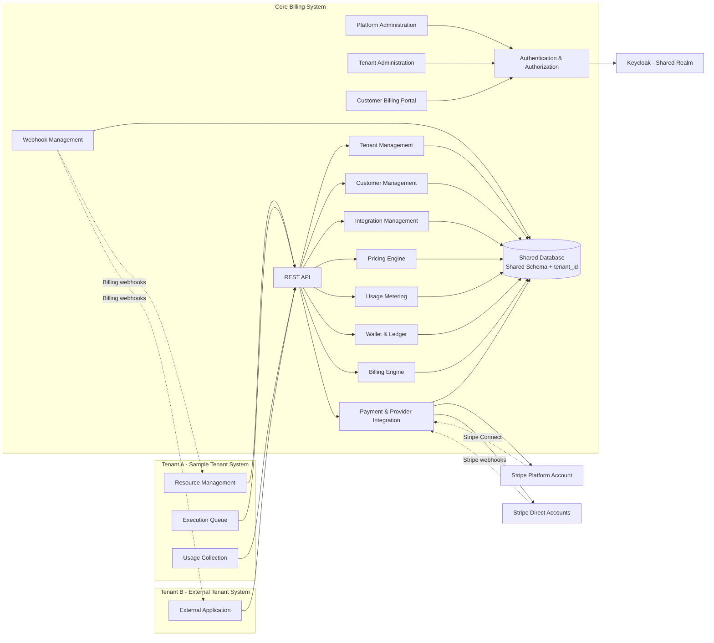

# Core Billing System – System Specification

## 1. System Scope

Build a standalone Core Billing System that acts as the central hub for financial operations and charging across many kinds of resource-rental services.

The system supports a Multi-tenant model. Many Tenants share one Platform while keeping independent data, accounts, integration configuration and Billing operations.

The system manages these components:

- Platform: the platform that provides and manages Billing.
- Tenant: a unit that uses the Billing System and has its own independent data and operations space.
- Billing Customer: the entity that represents a Tenant's customer inside the Billing System.
- Billing User: a user who administers the Platform or a Tenant.
- Tenant System: the Tenant's business system, responsible for providing and operating the service.

Supported pricing models:

- Time-based.
- Usage-based.
- Workload-based.
- Event-based.
- Subscription.
- Hybrid Pricing.

Main functions:

- Pricing Engine: defines and calculates cost under multiple pricing models.
- Usage Metering: records resource consumption.
- Cost Estimation: estimates cost before execution.
- Wallet & Ledger: manages balances and the history of financial transactions.
- Reservation: holds budget in advance and releases the unused part.
- Charge: calculates and deducts actual cost.
- Invoice: manages invoices and payment information.
- Payment: integrates Payment Providers to process payments and top up Wallets.
- Refund: supports refunds through the Payment Provider and updates the related Wallet and Ledger transactions.
- Subscription: manages recurring service subscriptions.
- Billing Session: lets a Tenant create a Session through which a Customer reaches the Billing UI, similar to Stripe Checkout and the Customer Portal.
- Webhook: receives and sends notifications about changes in Billing business state.
- Payment Provider Configuration: lets each Tenant configure and manage its own Payment Provider account.

The system supports both Prepaid and Postpaid Billing.

## 2. Multi-tenancy and Data Isolation

### 2.1. Tenant Architecture

One Platform can manage many Tenants. Each Tenant is treated as an independent business space.

Principles:

- Each Tenant has a unique `tenant-code`.
- Each Tenant has its own data, configuration and Billing operations.
- Data must not be accessible across Tenants.
- Wallet, Ledger, Invoice, Payment, Refund, Subscription and Customer all belong to a Tenant scope.
- The same email can exist in several Tenants as independent accounts.
- A User of one Tenant does not implicitly have access to another Tenant.
- A Tenant can integrate one or more Tenant Systems.

### 2.2. Data Isolation Strategy

Shared Database + Shared Schema + Tenant ID.

- Tenants share the same Database and Schema.
- Tenant-scoped business tables carry a `tenant_id` column.
- Every data query must be restricted by the Tenant Context.
- Authorization must check the Tenant Scope before allowing access.
- Data relationships must make cross-Tenant references impossible.
- Unique constraints must include `tenant_id` when the identifier is scoped to a Tenant.
- PostgreSQL Row-Level Security may be used as an additional layer of protection.

### 2.3. Tenant Resolution and Domain

Each Tenant is accessed through a subdomain:

| Domain                     | Scope                   |
| -------------------------- | ----------------------- |
| `platform.base-domain.com` | Platform Administration |
| `tenant-a.base-domain.com` | Tenant A                |
| `tenant-b.base-domain.com` | Tenant B                |

Requirements:

- Each Tenant has a unique `tenant-code`.
- The Tenant is determined automatically from the request hostname.
- A Tenant Context is built and carried through all processing layers.
- Background Jobs and Event Consumers must carry the Tenant Context.
- A `tenant_id` supplied by the Client must not be trusted to determine access rights.
- The design must support Domain Mapping so Custom Domains can be added in the future.

## 3. Authentication and Authorization

### 3.1. Authentication

Keycloak is the shared Identity Provider for the whole Platform.

- Use a single shared Keycloak Realm.
- Integrate through OAuth 2.0 / OpenID Connect.
- Keycloak handles Authentication, Credentials and login session management.
- The Billing System uses the OIDC Subject (`sub`) to link to the internal User.
- A User's identity is distinguished per Tenant.
- Email is not used as the sole identifier across the whole Platform.
- The same email may exist in several Tenants under independent identities.

Keycloak must be configured to support duplicate emails. The username, or whatever login identifier is used, must be Tenant-scoped, because usernames are unique within a Realm by default.

### 3.2. Authorization

The Billing System manages Authorization through a Hybrid RBAC model.

Components:

- User: an account of a person administering Billing.
- Role: a customizable group of Permissions.
- Permission: the right to perform one specific action.
- Role Assignment: assigns a Role to a User within a Scope.
- Role Permission: defines which Permissions belong to a Role.
- User Permission: supports granting a Permission directly to a User.
- Authorization Policy: the mechanism that checks access based on Permission, Scope and extra conditions when needed.

Two authorization scopes are supported:

- Platform Scope: administers the whole Platform and its Tenants.
- Tenant Scope: administers data and operations within a Tenant.

A User can have several Roles and Permissions in different Scopes.

Roles are managed dynamically through the Database and the UI and are not hardcoded. The system may provide some default Roles when a Platform or Tenant is initialized.

Keycloak is responsible only for Authentication; the Billing System is responsible for Authorization.

## 4. User and Customer Management

### 4.1. Billing User

A User is an account used to access and administer the Billing System.

- Platform User: administers the Platform.
- Tenant User: administers and operates Billing within a Tenant.
- A User can use the same email in several Tenants, but those are treated as independent accounts.
- A User is linked to a Keycloak Identity through the OIDC Subject.
- Roles and Permissions are managed by the Billing System.

### 4.2. Billing Customer

A Billing Customer is the entity that represents a customer using a Tenant's services.

- Each Customer belongs to one Tenant.
- A Customer is managed independently of the Tenant System's User account.
- A Customer is not required to have a Billing login account.
- A Customer can be given access to Billing through a Billing Session.
- A Customer owns the Wallet, Usage, Charge, Invoice, Payment and Subscription information within the supported business scope.

### 4.3. Tenant User Mapping

User accounts of the Tenant System are outside the Billing System's management scope.

The Tenant System manages its own User accounts and maps them to Billing Customers.

Relationship:

1 Tenant User ↔ 1 Billing Customer within the same Tenant.

The mapping is stored as a record in the Billing System and contains at least:

- `tenant_id`
- `tenant_system_id`
- `external_user_id`
- `billing_customer_id`

The Billing System does not manage the passwords, Roles or Permissions of a Tenant User.

Example:

| Tenant   | Tenant User | Billing Customer |
| -------- | ----------- | ---------------- |
| Tenant A | `user_001`  | `cus_001`        |
| Tenant B | `user_001`  | `cus_002`        |

Two Tenants may use the same `external_user_id` or email, but their Billing Customers are completely independent.

## 5. Pricing and Billing Engine

### 5.1. Pricing Engine

Provides the mechanism for defining and calculating prices for services.

Supports:

- Time-based Pricing.
- Usage-based Pricing.
- Workload-based Pricing.
- Event-based Pricing.
- Subscription Pricing.
- Hybrid Pricing.

A Pricing Plan can define:

- Billing unit.
- Unit price.
- Price tiers (Tiered Pricing).
- Usage thresholds.
- Billing cycle.
- Minimum / Maximum Charge.
- Rounding policy.
- Currency.
- Validity period.

### 5.2. Usage Metering

Receives and records Usage from the Tenant System.

- Records Usage Events.
- Supports many Metric types and units of measure.
- Supports recording Usage over time.
- Supports Idempotency to avoid duplicate records.
- Supports aggregating Usage for billing.
- Keeps a trace of where each Usage originated.

### 5.3. Cost Estimation

Provides an API that estimates cost before the Tenant System executes a Resource or Workload.

The estimate can be used as the basis for a Reservation.

### 5.4. Wallet & Ledger

- Manages Wallets per Tenant and Customer.
- Supports multiple Currencies when configured.
- Records every balance change through the Ledger.
- Supports Credit, Debit, Hold and Release.
- Guarantees consistency and auditability.
- Ledger transaction history is never edited directly.

### 5.5. Reservation

Lets the Tenant System hold a budget in advance.

- Checks the balance or the Postpaid limit.
- Holds budget before the Resource is executed.
- Supports Capture or Charge from a Reservation.
- Releases the remaining budget.
- Supports Expiration and handling of expired Reservations.
- Guarantees Idempotency and avoids duplicate holds.

### 5.6. Charge

Calculates and records actual cost incurred.

- Supports Charge from Usage.
- Supports Charge from a Reservation.
- Supports standalone Charge.
- Validates the transaction.
- Updates the Wallet and Ledger.
- Records Charge status and history.

### 5.7. Prepaid and Postpaid

Prepaid:

- The Customer tops up the Wallet.
- Billing checks the balance before a Reservation or Charge.
- Cost is deducted from the available balance.

Postpaid:

- The Customer uses the service first and pays later.
- The system manages the Credit Limit and Outstanding Balance.
- Incurred debt is recorded.
- Supports aggregation cycles and Invoice generation.
- Supports paying off the debt.

### 5.8. Invoice and Subscription

Invoice:

- Manages Invoices and Invoice Items.
- Supports Invoices generated from Charges or Subscriptions.
- Manages payment status.
- Tracks debt and payment history.

Subscription:

- Manages recurring service subscriptions.
- Supports Billing Cycles.
- Supports renewal and recurring charges.
- Records Subscription Events.
- Does not directly provision or stop Resources.

## 6. Payment Provider and Stripe Integration

### 6.1. Payment Provider Architecture

The Billing System supports multiple Payment Providers through a Provider Integration mechanism.

Each Tenant configures and manages its own Payment Provider.

Each Tenant has one Stripe Account Configuration.

Principles:

- Stripe is not a shared payment account of the Platform for all Tenants.
- Each Tenant owns an independent Stripe configuration.
- Payments and Refunds must be performed through the corresponding Tenant's configuration.
- Transaction data and integration information must be isolated between Tenants.
- Other Payment Providers can be added in the future.

### 6.2. Stripe Integration Modes

Two integration modes are supported:

Mode 1 – Direct Stripe Integration

The Tenant supplies its own Stripe API Credentials.

- The Tenant manages its own Stripe Account.
- The Tenant provides the Secret Key and any required authentication information.
- The Billing System uses the Tenant's Credentials to perform Payments and Refunds.
- Webhooks are verified with the matching Webhook Secret.

Mode 2 – Stripe Connect

Lets a Tenant link a Stripe account through Stripe Connect.

- The Platform owns a Stripe Platform Account used for Stripe Connect.
- The Tenant goes through the Stripe account linking flow.
- The Billing System stores the matching Connected Account information.
- Transactions run on the correct Connected Account according to the chosen Stripe Connect model.
- Supports managing the connection status and which Stripe capabilities the Connected Account can use.
- Receives and verifies Webhooks from Stripe Connect.

Stripe Connect lets a Tenant link an account without giving its Secret Key directly to the Billing System.

### 6.3. Stripe Configuration

Each Tenant has at most one active Stripe Account Configuration at a time.

Configuration fields:

| Attribute         | Description                     |
| ----------------- | ------------------------------- |
| Integration Mode  | Direct or Connect               |
| Account ID        | Stripe Account ID               |
| Secret Key        | Credential for Direct Mode      |
| Publishable Key   | Public Key, if needed           |
| Webhook Secret    | Secret for verifying Webhooks   |
| Environment       | Test / Live                     |
| Connection Status | Connection state                |
| Connected At      | When the account was linked     |
| Last Verified At  | Most recent verification time   |

Sensitive information must be encrypted or managed through a Secret Manager. The Secret Key and Webhook Secret must not be returned by ordinary configuration read APIs.

The Platform-level Stripe Connect configuration must be distinguished from the Tenant's own Stripe Account configuration: the Platform manages the Connect Application and OAuth, while the Tenant owns the Connected Account.

### 6.4. Payment and Refund

- Create Payments through the Tenant's Stripe Configuration.
- Support topping up the Wallet.
- Synchronize Payment status.
- Support full and partial Refunds where the business rules allow.
- Guarantee Idempotency for Payments and Refunds.
- Reconcile transactions with Stripe.
- Update the Wallet and Ledger based on verified transaction results.
- Never record success based only on the browser Redirect result.

Stripe processes the payment transaction; the Billing System synchronizes status and updates the financial ledger.

### 6.5. Stripe Webhook

- Support Webhooks for Direct Integration.
- Support Webhooks for Stripe Connect.
- Verify the Webhook signature.
- Identify the related Tenant and Stripe Account.
- Prevent duplicate Event processing.
- Support Retry and handling of failed Events.
- Record Event processing history.

## 7. Billing Session and Customer Portal

The Billing System provides a standalone Billing Portal UI through which a Customer manages financial information.

The Tenant System can create a Billing Session through an API.

A Billing Session has these characteristics:

- Created for one specific Billing Customer.
- Has an expiry time.
- Has a predefined access scope.
- Does not allow access to other Customers.
- Supports Redirect to the Billing Portal.
- Can limit functions through Session Permissions.

Customer Portal functions:

- View Customer information.
- View Wallet and balance.
- View Ledger and transaction history.
- View Usage and Charges.
- View Invoices.
- Top up and pay.
- View Subscriptions.
- View Payment and Refund history.
- Manage payment methods within what Stripe supports.

The Customer Portal does not depend on the Tenant System's UI or its internal account system.

## 8. Webhook and Event Integration

### 8.1. Tenant System → Billing System

The Billing System provides a REST API and a mechanism for receiving Events from the Tenant System.

Integrated operations include:

- Customer Mapping.
- Pricing and Cost Estimation.
- Reservation.
- Usage Metering.
- Charge.
- Refund Request, if authorized.
- Related business Events.

### 8.2. Billing System → Tenant System

The Billing System proactively sends Webhooks when business state changes.

Examples:

| Event                         | Meaning                          |
| ----------------------------- | -------------------------------- |
| `reservation.created`         | A Reservation was created        |
| `reservation.expired`         | A Reservation expired            |
| `reservation.released`        | A Reservation was released       |
| `charge.succeeded`            | A Charge succeeded               |
| `charge.failed`               | A Charge failed                  |
| `payment.succeeded`           | A Payment succeeded              |
| `payment.failed`              | A Payment failed                 |
| `refund.succeeded`            | A Refund succeeded               |
| `invoice.created`             | An Invoice was created           |
| `invoice.paid`                | An Invoice was paid              |
| `subscription.renewed`        | A Subscription was renewed       |
| `subscription.payment_failed` | A Subscription payment failed    |

Principles:

- A Webhook only reflects a business state or result.
- Events are not used to impose actions on the Tenant System.
- The Tenant System defines its own policy for handling received Events.
- Supports Retry, Signature Verification and Idempotency.
- Keeps delivery history and processing status, and supports resending a Webhook.
- A Tenant can configure Webhook Endpoints and the Event types it wants to receive.

For example, on receiving `payment.failed`, the Tenant System can decide by itself to record a debt, extend the payment period, suspend the Resource, or keep providing the service.

The Billing System does not decide on the Tenant System's behalf.

## 9. Responsibilities of the Billing System

The Billing System is responsible for:

- Managing the Platform, Tenants, Billing Customers and related Billing information.
- Managing Users, Roles, Permissions and Authorization.
- Integrating Keycloak to authenticate users.
- Managing Tenant Context and Data Isolation.
- Managing Tenant Domains and Integration Credentials.
- Managing the Tenant User Mapping to Billing Customers.
- Managing Pricing Plans and the Pricing Engine.
- Calculating and estimating cost.
- Checking balances, holding budget and deducting cost.
- Recording Usage and managing financial transactions.
- Managing Wallet, Ledger, Reservation, Charge, Invoice, Payment, Refund and Subscription.
- Managing Payment Provider Configuration independently per Tenant.
- Integrating Stripe Direct and Stripe Connect.
- Providing a REST API for the Tenant System.
- Providing an API to create Billing Sessions.
- Receiving Events/Webhooks from the Tenant System and Stripe.
- Proactively sending Webhooks about Billing state changes.
- Ensuring financial consistency, Idempotency and auditability.
- Providing the Platform Administration, Tenant Administration and Customer Billing Portal interfaces.

## 10. Responsibilities of the Tenant System

The Tenant System is responsible for managing and operating the service, including:

- Managing its own User accounts, Roles and business Permissions.
- Managing Customers and the mapping to Billing Customers.
- Managing Resources, Orders and Execution.
- Managing the Resource Lifecycle.
- Managing the Execution Queue and Background Workloads.
- Integrating the Billing System through REST API, Events and Webhooks.
- Supplying Usage information so Billing can charge.
- Performing Cost Estimation before deploying a Resource.
- Checking the Reservation result before putting work into the Queue.
- Sending a Charge request when actual cost is incurred.
- Deciding whether to execute, renew, suspend or stop the service.
- Defining its own policy for handling Billing state changes.
- Creating Billing Sessions so Customers can reach the Billing UI when needed.

The Tenant System does not directly manage the Billing System's Ledger, Wallet or internal financial operations.

## 11. Sample Tenant System

The project must build a complete Sample Tenant System that serves as a reference system for verifying integration with, and use of, the Core Billing System's functions.

The Sample Tenant System follows a Cloud Resource Management model that simulates a platform for renting resources.

### 11.1. Business Functions

- User Registration and Authentication.
- User account management.
- Business Role and Permission management.
- Customer management.
- Customer Mapping with the Billing System.
- Resource Catalog management.
- Resource Order management.
- Resource Lifecycle management.
- Execution and Background Workload management.
- Resource Usage tracking.
- Management of Billing-related transactions.
- Billing Webhook handling.
- A Customer Portal and Resource Management UI.

### 11.2. Resource Types

| Resource            | Illustrated pricing model |
| ------------------- | ------------------------- |
| Compute Instance    | Time-based                |
| Storage             | Usage-based               |
| Bandwidth           | Usage-based               |
| Background Workload | Workload-based            |
| API Operation       | Event-based               |
| Managed Service     | Subscription              |
| Cloud Package       | Hybrid Pricing            |

### 11.3. Integration Scenarios

The Sample Tenant System must demonstrate:

1. User registration and creating a Customer Mapping.
2. Fetching a Pricing Plan and performing Cost Estimation.
3. Checking the Wallet and performing a Reservation.
4. Creating a Resource Order and putting it into the Execution Queue.
5. Recording Usage during use.
6. Performing a Charge when cost is incurred.
7. Releasing the Reservation and updating the remaining budget.
8. Topping up through Stripe.
9. Supporting Stripe Direct and Stripe Connect.
10. Viewing Invoices and transaction history.
11. Handling Webhooks when Billing state changes.
12. Using Subscriptions and combined pricing models.
13. Supporting both Prepaid and Postpaid.
14. Testing data isolation between multiple Tenants.
15. Testing the case of the same email with independent accounts in several Tenants.

The Sample Tenant System must be deployable independently of the Billing System, but it needs the Billing System to use the financial functions.

## 12. Division of Responsibilities

- The Billing System manages only financial operations and does not operate on Resources directly.
- The Tenant System controls the Resource lifecycle and execution.
- Keycloak is responsible only for Authentication; the Billing System is responsible for Authorization.
- The Tenant System manages its own business User accounts.
- A Billing Customer is an independent entity and is not the same as a Tenant User.
- The Billing System publishes business state and results through API, Events and Webhooks; it does not impose actions on the Tenant System.
- The Tenant System decides its next action based on the states it receives.
- Stripe processes payment transactions; the Billing System synchronizes status and updates the financial ledger.
- Each Tenant has an independent Stripe Account Configuration, supporting Direct Integration and Stripe Connect.
- A Customer can only access and act within the scope of the Billing Session issued to them.
- Tenants must be fully isolated in data and access rights.
- The two systems are independent and communicate through API and Events.

## 13. Relationships Between Components

| Component               | Role                                                         |
| ----------------------- | ------------------------------------------------------------ |
| Platform                | Platform that provides and manages Billing                   |
| Tenant                  | Unit that uses Billing                                       |
| Tenant System           | System that manages the Tenant's services and resources      |
| Tenant User             | Business user belonging to the Tenant System                 |
| Billing User            | User who administers the Billing System                      |
| Billing Customer        | Customer managed inside Billing                              |
| Tenant Customer Mapping | Links a Tenant User to a Billing Customer                    |
| Keycloak                | Identity Provider                                            |
| Stripe                  | Payment Provider                                             |
| Stripe Connect          | Mechanism for linking a Tenant's Stripe Account to the Platform |
| Sample Tenant System    | Reference system for integration testing                     |

One Platform can have many Tenants. Each Tenant can integrate one or more Tenant Systems and manage many Customers.

Each Tenant can have many Users and Billing Customers. Users and Customers are linked through the Tenant Customer Mapping.

## 14. High-level System Architecture

The diagram shows the components and integration relationships at a high level. The Stripe Platform Account serves Connect; a Tenant's Stripe Accounts can be linked through Connect or integrated directly.

## 15. Technical Principles to Guarantee

| Group                 | Requirement                                                              |
| --------------------- | ------------------------------------------------------------------------ |
| Multi-tenancy         | Tenant Context is determined and controlled centrally                    |
| Data Isolation        | No cross-Tenant access                                                   |
| Identity              | One email can have several independent accounts per Tenant               |
| Authorization         | Hybrid RBAC, Permissions by Platform/Tenant Scope                        |
| Financial Consistency | The Ledger is the audit source for financial transactions                |
| Idempotency           | No duplicate transaction is recorded on retry                            |
| Reservation           | Holding and releasing budget stays consistent                            |
| Integration           | REST API, Events and Webhooks                                            |
| Payment               | Tenant-owned Stripe Configuration, Direct and Connect                    |
| Credential Security   | Encrypted Credentials, Secret Management support                         |
| Reliability           | Retry, Outbox, Dead Letter and integration error handling                |
| Audit                 | Trace administrative actions and transactions                            |
| Extensibility         | Support adding Payment Providers, Pricing Models and Tenant Systems      |

## 16. Security and Operations Requirements

Beyond business functions, the system must ensure:

Authentication & Session

- OIDC authentication through Keycloak.
- Validate Token Issuer, Audience, Expiration and Subject.
- Distinguish Platform and Tenant Context.
- A Session from one Tenant must not be usable in another Tenant.

Data Security

- Tenant-scoped data access.
- Composite Foreign Keys for important relationships.
- PostgreSQL RLS where appropriate.
- Do not expose sensitive data through Logs, APIs or Webhooks.

Payment Security

- Encrypt the Stripe Secret Key and Webhook Secret.
- Verify the Stripe Webhook Signature.
- Do not store payment card information directly.
- Use Stripe-hosted Checkout or the Payment Element where appropriate.
- Reconcile transactions and handle Webhooks that arrive late or out of order.

Reliability

- Transactional Outbox for important Events.
- Bounded Retry with Backoff.
- Dead Letter Queue.
- Idempotent Consumer.
- Audit Log.
- Monitoring and Distributed Tracing.

## 17. Project Scope Summary

The project consists of two main systems:

Core Product

Core Billing System

A standalone Billing system that manages all financial operations, Multi-tenancy, Pricing, Wallet, Ledger, Reservation, Charge, Invoice, Payment, Refund and Subscription.

Reference Implementation

Sample Tenant System – Cloud Resource Management

A complete sample system that verifies Billing integration and simulates Compute, Storage, Bandwidth and Workload services.

The two systems are deployed independently and communicate through REST API, Events and Webhooks.

Final goal: the Core Billing System can be used by many different Tenant Systems regardless of service type, deployment technology or each Tenant's internal business structure.

A final architecture note on Stripe: with Stripe Connect, Direct Charges, Destination Charges and Separate Charges and Transfers must be clearly distinguished. They are different money-flow models and affect who is responsible for collecting fees, Stripe fees, Refunds and Disputes. The current specification establishes support for Connect, and the specific transaction model should be decided during the Payment Domain design phase.
