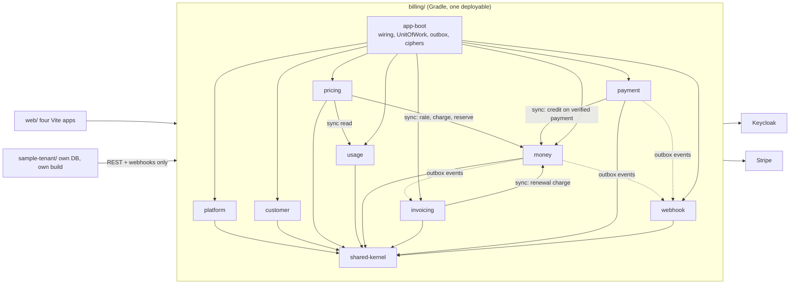

# Core Billing implementation

## Overview

The repository holds only documentation. This plan builds, in order: the Core Billing backend (`billing/`), the Sample Tenant System (`sample-tenant/`) and the web workspace (`web/`), so that every one of the 15 scenarios in [sample-tenant-system.md](../../docs/sample-tenant-system.md) runs end to end. The maintained contract is the topic documents under `docs/`; the decisions in [architecture.md](../../docs/architecture.md) and the three advisory reports in `plans/reports/` are binding. Where this plan adds a decision, the phase says so and the last phase writes it back into `docs/architecture.md`.

## Outcome, constraints, non-goals, acceptance

- **Outcome.** Two independently deployable systems plus web apps. Billing owns every financial fact; the Sample Tenant System proves the integration using only REST, events and webhooks.
- **Constraints.** Java and Spring Boot, DDD and Clean Architecture, Gradle multi-module modular monolith, Spring Data JDBC (no JPA), plain-Java `domain` and `application` layers, one ACID transaction for the money path including its outbox row, append-only single-entry Ledger, shared schema with `tenant_id`, composite foreign keys and PostgreSQL RLS, Keycloak for authentication only, Billing-issued API keys for Tenant Systems, Stripe Direct charges. Frontend is React, Vite and TanStack in one monorepo of separate apps.
- **Non-goals.** Providers other than Stripe (the `PaymentProvider` port is the only seam), custom domains (the domain-mapping table is the only seam), CQRS, event sourcing, microservices, Billing managing Tenant resources or users, deploy pipelines and infrastructure-as-code.
- **Acceptance.** Every success criterion below is checked; each phase's Verification section passes; the 15 scenarios pass in the end-to-end suite of phase 14.

## Assumptions carried into the plan

Items 1, 2, 3, 6 and 7 were confirmed by the project owner on 2026-11-09; items 4 and 5 remain assumptions. Each is recorded in `docs/architecture.md` in phase 14.

1. One repository with `billing/`, `sample-tenant/`, `web/` and `contracts/` at the root (open decision 2).
2. `web/` is a pnpm workspace of four Vite apps plus shared packages (open decision 3).
3. Keycloak login identifier is the username `{tenant-code}:{email}`, built by the Billing UI from the hostname, with duplicate emails allowed in the realm (open decision 1). No custom Keycloak extension.
4. Java root package `io.corebilling` (renamable in phase 1 only; free to change before any code exists).
5. Charge from usage is orchestrated in `pricing`, which reads quantities through `usage.api` (read-only) and calls `money.api`. This adds one read-only synchronous edge to the money path in the architecture document.
6. Refunding a wallet top-up is allowed only up to the unspent balance, because a refund must not drive a Prepaid wallet negative.
7. UI kit is Tailwind CSS with shadcn/ui (Radix) components.

## Phases

| # | Phase | Effort | Depends on | Status |
|---|-------|--------|-----------|--------|
| 1 | [Foundation and enforcement](./phase-01-foundation-and-enforcement.md) | 3d | none | Completed |
| 2 | [Tenancy core, UnitOfWork and RLS](./phase-02-tenancy-core-unit-of-work-rls.md) | 4d | 1 | Completed |
| 3 | [Identity and access](./phase-03-identity-and-access.md) | 6d | 2 | Pending |
| 4 | [Customers and tenant mapping](./phase-04-customers-and-mapping.md) | 2d | 3 | Pending |
| 5 | [Money: wallet, ledger, reservation, charge](./phase-05-money-wallet-ledger-reservation-charge.md) | 7d | 4 | Pending |
| 6 | [Outbox relay and outbound webhooks](./phase-06-outbox-relay-and-outbound-webhooks.md) | 4d | 5 | Pending |
| 7 | [Pricing, usage and cost estimation](./phase-07-pricing-usage-estimation.md) | 6d | 5 | Pending |
| 8 | [Payments and Stripe](./phase-08-payments-and-stripe.md) | 7d | 5, 6 | Pending |
| 9 | [Invoicing and subscriptions](./phase-09-invoicing-and-subscriptions.md) | 6d | 7, 8 | Pending |
| 10 | [Billing session and portal API](./phase-10-billing-session-and-portal-api.md) | 3d | 5, 8 | Pending |
| 11 | [Sample Tenant System backend](./phase-11-sample-tenant-backend.md) | 8d | 7, 8, 9, 10 | Pending |
| 12 | [Web workspace and admin apps](./phase-12-web-workspace-and-admin-apps.md) | 8d | 3, then contracts from 4-9 | Pending |
| 13 | [Customer portal and sample tenant UI](./phase-13-customer-portal-and-sample-ui.md) | 7d | 10, 11, 12 | Pending |
| 14 | [End-to-end scenarios, hardening and docs](./phase-14-e2e-hardening-docs.md) | 5d | all | Pending |

Phases 1 to 5 are strictly sequential: they prove every architectural rule on one real money flow before the remaining contexts copy it. After phase 7, phases 8, 9 and 10 touch separate modules and can be built in parallel by file ownership; phase 12 can start once phase 3 publishes an OpenAPI contract and follows each later API. Only phase 1 needs a decision-heavy spike; the rest follow known patterns.

## Architecture at a glance

## Extension trace

- **Second payment provider** (the credible variant): the stable contract is the `PaymentProvider` port in `payment.application` plus the verified-event path into `money.api`. Changing pieces are one adapter, one enum value and one provider-config row type. Phase 8 proves it with a contract test run against a fake in-memory provider, with no registry, plugin loader or SPI.
- **New pricing model**: a new strategy class inside `pricing.domain` behind the existing calculator interface; `money` is untouched (proved by phase 7 tests).
- **Second Tenant System for the same Tenant**: already carried by `tenant_system_id` in the mapping and the credential.

## Red-team notes (resolved or carried as tasks)

| Risk | Resolution | Where |
|---|---|---|
| The architecture says one Gradle module holds `domain`, `application` and `adapter`, so a single compile classpath cannot ban Spring from only the first two. | Spike three Gradle source sets per module (`domain`, `application`, `adapter`) with distinct classpaths via a convention plugin. If the IDE or Modulith cannot cope, fall back to ArchUnit plus a grep gate and record the weaker guarantee. | Phase 1 |
| Spring Modulith may not discover modules split across Gradle modules that share a root package. | Time-boxed spike; fallback is ArchUnit only for boundaries and Modulith only for event documentation. | Phase 1 |
| RLS does not apply to the table owner or to a superuser, so a mis-configured connection silently bypasses it. | Separate migration owner role and a non-owner application role with no BYPASSRLS; a test asserts a query with no tenant set returns zero rows. | Phase 2 |
| `SET LOCAL` is lost or leaks on a pooled connection if issued outside a transaction. | Set it with `set_config('app.tenant_id', ?, true)` as the first statement inside the UnitOfWork transaction; an ArchUnit rule bans other code paths from touching the datasource. | Phase 2 |
| Ledger order by a database sequence can commit out of order. | A per-wallet sequence is assigned while the wallet row is locked, with a unique `(wallet_id, seq)` index. | Phase 5 |
| Spring Data JDBC silently drops a change when `save` is forgotten. | Every repository write path has a reload-and-compare test. | Phases 4-10 |
| Out-of-order or replayed Stripe events regress a payment state. | Monotonic state transitions, unique `(stripe_account, event_id)` inbox row, and re-fetch from Stripe when a transition is ambiguous. | Phase 8 |
| An SSRF through Tenant-configured webhook URLs. | HTTPS-only outside dev, resolved-address check blocking loopback and private ranges, no redirects followed, bounded timeouts and response size. | Phase 6 |
| API key compared by plain string equality or stored raw. | Look up by key id, compare a SHA-256 of the high-entropy secret in constant time, never log it. | Phase 3 |
| Rate limiting state lives per instance. | Accepted for a single-instance start; the limiter sits behind a port and the limit is documented as approximate across instances. | Phase 3 |

## Success criteria

- [ ] `./gradlew build` in `billing/` is green and turns red on a deliberate layer, purity or cross-context violation (meta-test proves it).
- [ ] Wallet, Ledger and outbox rows commit together and roll back together (Testcontainers test).
- [ ] No test can read or write another Tenant's rows, including through raw SQL on the application role.
- [ ] Payments, wallet top-ups and refunds change the Ledger only from verified Stripe events; a browser redirect alone changes nothing.
- [ ] Duplicate requests with the same idempotency key produce one Ledger entry, one payment, one refund and one usage event.
- [ ] `sample-tenant/` builds and starts with no Gradle dependency on `billing/` and talks to it only over HTTP.
- [ ] All four web apps build, pass type checks and their Playwright flows.
- [ ] The end-to-end suite passes all 15 scenarios.
- [ ] `docs/` describes the delivered system and `docs/architecture.md` has no open decisions left from this plan.
