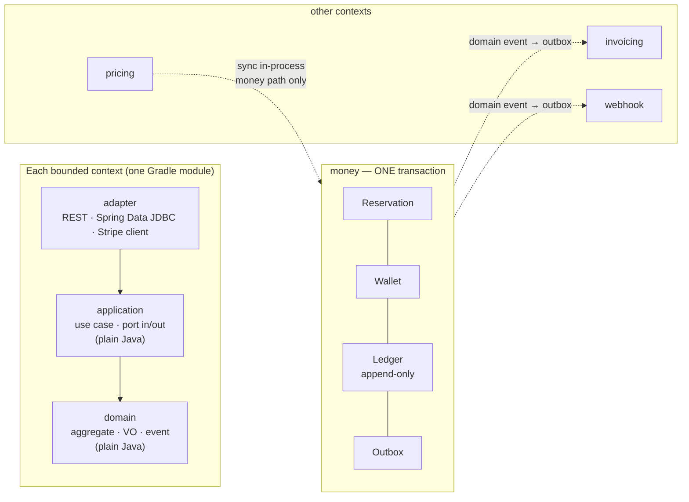

# Core Billing — DDD and Clean Architecture, strictly applied

Date: 2026-11-09 · Scope: how to apply DDD + Clean Architecture "strictly" to Core Billing before any code exists · Status: advisory, no code written.

## Confirmed reframing

**Problem.** Strict DDD + Clean is needed for a production billing platform that will live for years, but the money requirement itself forbids the extreme reading of DDD (one transaction per aggregate or per context). So "strict" must be defined by **dependency rules that CI can verify** and by **plain-Java domain and application layers**, not by the number of transactions or the number of DTO layers. The context boundary is data ownership; the transaction is a separate decision made by the money path.

**Project owner's decisions**

| Topic | Choice |
|---|---|
| Objective | Long-lived production foundation; ceremony is accepted to avoid architectural debt |
| ACID vs context boundary conflict | Money's ACID wins; the boundary is expressed by data ownership + dependency rules |
| Structure | Module per bounded context, with `domain` / `application` / `adapter` layers inside |
| Purity | `domain` **and** `application` are plain Java (no Spring/JPA/Jackson) |
| Persistence | Spring Data JDBC instead of JPA |
| Transaction | `UnitOfWork` is a plain-Java port owned by the application; use cases wrap themselves; the Spring implementation lives in infrastructure |
| Cross-context communication | Hybrid: synchronous in-process only for the money path; everything else uses domain events through the outbox |
| Enforcement | ArchUnit + Spring Modulith from day one |

**Exact requirements**

1. Each bounded context is a Gradle module: `platform`, `customer`, `pricing`, `usage`, `money`, `invoicing`, `payment`, `webhook`, plus `shared-kernel` and `app-boot`.
2. Each module has three layers: `domain` / `application` / `adapter`; `domain` and `application` are plain Java.
3. Dependency rule: `adapter → application → domain`; `app-boot` only wires; `shared-kernel` holds only value objects and plain-Java technical ports.
4. `money` owns Wallet, Ledger (append-only), Reservation and Charge, and the whole path runs in **one transaction**, including the outbox row.
5. Cross-context: synchronous in-process calls through the public interface **only on the money path**; everything else emits domain events through the outbox.
6. ArchUnit (layer + import + purity) and Spring Modulith (`verify()`, event docs) run in the build; a violation turns the build red.
7. `TenantId` is a value object in every command and aggregate — a raw `tenant_id` is never threaded through the domain; RLS is the second line of defence.
8. No domain code is shared between `billing` and `sample-tenant`; the sample tenant depends only on its own HTTP client.

**Goals.** An architecture that survives years of extension, strongly consistent money, automated evidence for module boundaries, and a newcomer who can read the rules and know where a change belongs.

**Done means**

- `./gradlew build` runs ArchUnit + Modulith; deliberately importing Spring into `domain` turns the build red (proven by a meta-test).
- An integration test (real PostgreSQL, Testcontainers) proves Wallet + Ledger + Outbox commit together, and roll back together.
- `grep` in `*/domain/**` and `*/application/**` for `org.springframework`, `jakarta.persistence`, `com.fasterxml.jackson` returns 0 results.
- ArchUnit reports 0 cross-context imports outside the public API package.
- `sample-tenant` builds independently, with no Gradle project dependency on `billing`.
- Modulith writes diagrams and event documentation into the build output.

**Non-goals.** CQRS, event sourcing, microservices, DTO-per-layer, splitting modules by layer, homemade DI/annotation frameworks.

**Constraints.** Java + Spring Boot, Gradle multi-module, modular monolith; Ledger append-only; idempotency mandatory; `tenant_id` + composite FK + RLS; the money path runs in one transaction.

## Preview of the target state



Mockup of one vertical slice (Charge):

```text
POST /api/v1/charges
  adapter/in/web/ChargeController          -- maps DTO, no business logic
    -> application/ChargeUseCase            -- port in: ChargeCommand(TenantId, ...)
       -> unitOfWork.transactional(() -> {
            money.domain.ChargeService      -- invariant: balance, reservation, idempotency
            application/port/out: LedgerPort, OutboxPort
              <- adapter/out/persistence/LedgerJdbcRepository  (Spring Data JDBC)
              <- adapter/out/outbox/OutboxJdbcAdapter
          })
  TX: wallet row + ledger entry + outbox row  (commit or rollback together)
```

Confirmed assumption: `pricing` calls `money` synchronously when it needs to hold or deduct money; `money` never calls back into `pricing` and instead receives the calculated amount through a command.

## Verdict

The direction is right, and more importantly: you avoided the biggest trap — treating "strict" as more layers, more DTOs, more abstractions. For Core Billing, **strict must mean few rules with teeth**: plain-Java domain and application layers, module boundaries blocked by CI, money inside one transaction. Your three decisions (one transaction for money, UnitOfWork as a port, Spring Data JDBC) are consistent with each other and with Spring Data JDBC itself, which has no persistence context or dirty checking — it maps one-to-one to aggregates better than JPA.

The real risk is not the model but **enforcement discipline**: UnitOfWork can be forgotten, `shared-kernel` will grow into a god module, and Modulith + ArchUnit will overlap if their roles are not split. The advice below concentrates on those three points.

## What you should do

1. **Enforce through the classpath first, tests second.** `domain` and `application` use a plain `java-library` convention plugin with no Spring/JPA/Jackson on the compile classpath — a violation is a compile error, stronger than ArchUnit. ArchUnit is only the second net for what the classpath cannot block (an adapter sitting inside a domain package, a cross-context import).
2. **Keep `shared-kernel` under ~10 types**: `TenantId`, `CustomerId`, `WalletId`, `Money`, `Currency`, `IdGenerator`, `Clock`, `UnitOfWork`, `DomainEvent`. No entities, no business rules, no `BaseEntity`/`BaseRepository`. If it exceeds that, split a module rather than adding more.
3. **`UnitOfWork` is a plain-Java port**, shaped as `transactional(Supplier<T>)`. The implementation uses `TransactionTemplate` (propagation `REQUIRED`, so nested calls join the right transaction). ArchUnit rule: every use case under `money..application..` must depend on `UnitOfWork` — the only way to turn "remember to open a transaction" into a CI failure.
4. **Put RLS inside the UnitOfWork implementation**, not everywhere: set `SET LOCAL app.tenant_id = ?` at the start of the transaction and reset it at the end. One place, impossible to forget, and tenant context never leaks into the domain.
5. **The `money` aggregates**: `Wallet` is the aggregate root holding the balance and its holds; `Reservation` is its own aggregate referencing `WalletId`; `LedgerEntry` is an append-only record with an insert-only repository. The Ledger is the audit source of truth; the Wallet balance is updated in the same transaction — never recompute it with `SUM(ledger)` on every request.
6. **The outbox is a port, `OutboxPort.append(...)`**, writing the outbox table inside the same `unitOfWork.transactional(...)` as the wallet and ledger. The poller uses `FOR UPDATE SKIP LOCKED`, retries with backoff, dead-letters, and deduplicates by event id.
7. **Idempotency through a unique constraint**, never check-then-insert: an `idempotency(tenant_id, key, ...)` table with a unique index, insert-first inside the same transaction; a duplicate key returns the previous result.
8. **Each context's public API is the `<ctx>.api` package** (interfaces plus command/result records). ArchUnit forbids any cross-context import outside `..api..`. This is what turns "context boundary" into a verifiable fact instead of a diagram on paper.
9. **Split the roles of Modulith and ArchUnit; do not let them overlap**: ArchUnit owns layer, import and purity rules; Spring Modulith owns `ApplicationModules.verify()` and event documentation. Every Spring annotation (`@ApplicationModuleListener`, `@Transactional`) lives in an adapter or in `app-boot`; Modulith still discovers modules by the shared root package.
10. **Keep persistence entities separate from the domain**: `*Row`/`*Record` classes carrying `@Table/@Id` live in `adapter/out/persistence` and are mapped to aggregates inside the adapter. The domain never sees an annotation.

## What you shouldn't do

- **Don't add a DTO and mapper per layer.** Commands and results in the application layer are `record`s; the adapter maps REST DTOs ↔ commands at the boundary. Mapping three times is ceremony that returns nothing.
- **Don't use `@Transactional` on the adapter when the use case already wraps `UnitOfWork`.** Pick one place; mixing both creates nested transactions and rollback bugs that are hard to find.
- **Don't put `BaseEntity`, `BaseAggregate` or `GenericRepository<T>` in `shared-kernel`.** That is the shortest path to a god-module kernel.
- **Don't write 30 ArchUnit rules.** 6–8 correct rules (purity, layer, cross-context, persistence-entity placement, money use case uses the UoW, `api` naming) are enough; extra rules only create artificial friction.
- **Don't share a Gradle module between `billing` and `sample-tenant`.** If an event contract is needed, generate it from JSON Schema/OpenAPI; never import classes.
- **Don't let a business invariant live in the `UnitOfWork` implementation, an RLS policy or the outbox poller.** Money is checked in the domain, not in infrastructure.
- **Don't create all 8 empty modules up front.** Build time and IDE friction grow before any flow proves the rules.
- **Don't use JPA anywhere** — including test helpers. Mixing two persistence models breaks the "one aggregate, one repository" property.

## What could be better / more efficient

Ranked by effort-to-impact:

1. **`build-logic/` convention plugins** (`java-conventions`, `domain-conventions`, `adapter-conventions`). Written once, inherited by every module; this is the strongest place to stop Spring leaking into the domain.
2. **Start with a vertical slice of `money` + `pricing` + `webhook`** instead of 8 modules. Prove every rule on one real Charge flow, then replicate.
3. **One meta-test that proves the rules have teeth**: a fixture that deliberately imports Spring into the domain, asserting the build fails. Without it, you do not know whether ArchUnit still runs or has been disabled.
4. **Money arithmetic**: `long` minor units or a fixed-scale `BigDecimal`, with invariants inside the `Money` VO (same currency, non-negative where required). Currency bugs are the most expensive and the easiest to miss.
5. **An event-contract generator**: JSON Schema as the source of truth, generating Java records for both systems. Keeps "no shared code" while staying type-safe.

## My take and how to get there

The route from the current state (docs only) to the goal:

1. Create `billing/settings.gradle.kts` and `build-logic/` with the three convention plugins.
2. Build `shared-kernel` (VOs + `UnitOfWork` + `Clock` + `IdGenerator`) and its purity test.
3. Build `money` with `domain` (Wallet, LedgerEntry, Reservation, ChargeService) + `application` (ChargeUseCase, ReserveUseCase, outbound ports) + `adapter/out/persistence` (Spring Data JDBC, row classes) + a thin `adapter/in/web`.
4. Add the `UnitOfWork` implementation (TransactionTemplate + `SET LOCAL app.tenant_id`) in `app-boot`/infrastructure, wired with `@Bean`.
5. Write ArchUnit + Modulith verify + the meta-test; make the build capable of going red.
6. Write a Testcontainers integration test: wallet + ledger + outbox commit together, and roll back together when a failure is injected after the outbox write.
7. Repeat for `pricing` (synchronous into `money`) and `webhook` (event → outbox → delivery), then extend to the remaining contexts.
8. Record these rules in `docs/architecture.md` (closing open decision #2) so they never have to be decided again.

**Extensibility check** (since you are shaping a shared boundary for several variants): the most credible extension is a **second payment provider**. Its route: add an adapter implementing the `PaymentProvider` port in `payment`, select it by enum in an `app-boot` factory, with per-tenant configuration already stored in the database; `money`, `invoicing` and `webhook` stay unchanged. So one port plus one implementation is enough; do **not** build an SPI, plugin registry or ServiceLoader — the spec asks for a "seam", not a two-way runtime plugin system. For pricing models, a strategy inside `pricing` is likewise enough; do not turn it into a configurable DSL.

## Benefits

- Domain and application tests run as plain JUnit, with no Spring context — fast and stable.
- Strongly consistent money: one transaction, one UnitOfWork, one place that sets the tenant.
- Module boundaries have automated evidence — a newcomer cannot break the architecture by accident.
- Spring Data JDBC forces small, explicit aggregates, which is closer to DDD than JPA.
- Changing the payment provider or adding a pricing model never touches `money`.

## Trade-offs

- **UnitOfWork inside the use case** makes the transaction boundary visible in the application layer. That is deliberate and fits money, but it is "visible infrastructure" — strict Clean adherents will object, and every new use case must remember to wrap (ArchUnit helps).
- **Plain-Java application layers** force you to write wiring in `app-boot`, with more `@Bean`s instead of `@Service` scattered around. A real cost, paid once in `app-boot`.
- **ArchUnit + Modulith together** are two mechanisms to maintain; without a clear split they duplicate rules and slow the build.
- **Synchronous `pricing → money`** creates direct coupling and a cross-module transaction; ACID is what you get in return. If `pricing` later needs to scale independently, you must split it and move to eventual consistency — that is when this model stops being right.
- **Spring Data JDBC** has no lazy loading and no dirty checking: an oversized aggregate loads slowly, and a forgotten `save()` silently drops a change — every write path needs a test.
- **Many Gradle modules** make builds and the IDE heavier; if the build crosses your tolerance, merge the rarely changing contexts instead of dropping the rules.

## Unverified

- Not confirmed that `ApplicationModules.verify()` discovers modules correctly when bounded contexts are **separate Gradle modules sharing one root package**. A small spike is needed; if it does not, move cross-context enforcement to ArchUnit only and keep Modulith for event docs.
- Spring Boot/Spring Modulith/Spring Data JDBC versions are not confirmed as compatible in this project (the repo has no build files yet).
- `SET LOCAL app.tenant_id` with a connection pool: needs re-verification behind PgBouncer in transaction pooling mode; with the default HikariCP it is safe.
- There is no CI configuration in the repo, so "build red" is currently a local behaviour, not a real gate.

## Work checklist

- [ ] Create `billing/settings.gradle.kts` and `build-logic/` with convention plugins for domain/application (no Spring) and adapters (Spring Data JDBC, web).
- [ ] Build `shared-kernel` with `TenantId`, `Money`, `Currency`, `UnitOfWork`, `Clock`, `IdGenerator` + purity test.
- [ ] Build `money`: `domain` (Wallet, append-only LedgerEntry, Reservation, ChargeService), `application` (use cases + in/out ports), `adapter` (Spring Data JDBC row classes + thin web).
- [ ] Implement `UnitOfWork` with `TransactionTemplate` + `SET LOCAL app.tenant_id`, wired in `app-boot`.
- [ ] Implement `OutboxPort` + outbox table + `FOR UPDATE SKIP LOCKED` poller + retry/DLQ/dedupe.
- [ ] Write ArchUnit (6–8 rules) + Modulith `verify()` + a meta-test proving the build fails on a violation.
- [ ] Testcontainers integration test: wallet + ledger + outbox commit together; roll back together when a failure is injected.
- [ ] Add `pricing` (synchronous into `money`) and `webhook` (event → outbox → delivery) to prove the cross-context rules.
- [ ] Record the decisions in `docs/architecture.md` and close open decision #2.

## Success metrics

- Deliberately importing `org.springframework` into `domain` or `application`: the build fails on the first run, proven by the meta-test.
- `grep -r "org.springframework\|jakarta.persistence\|com.fasterxml.jackson" billing/*/src/main/java/**/domain billing/*/src/main/java/**/application` returns 0.
- ArchUnit: 0 cross-context import violations; 100% of use cases under `money..application` depend on `UnitOfWork`.
- Rollback test: after injecting a failure, the number of changed wallet/ledger/outbox rows = 0.
- Idempotency test: sending the same key twice yields exactly one ledger entry and identical responses.
- `sample-tenant` builds independently: no Gradle project dependency points at `billing`.

## Handoff brief

```text
Objective: Build the Core Billing foundation with strict DDD + Clean: bounded-context Gradle modules, plain-Java domain/application layers, a UnitOfWork port, Spring Data JDBC, and a single-transaction money path.
Done means: domain and application contain no Spring/JPA/Jackson (grep = 0); ArchUnit + Spring Modulith verify run in the build and the build goes red on a deliberate violation (proven by a meta-test); money use cases wrap UnitOfWork and ArchUnit confirms it; a Testcontainers integration test proves wallet + ledger + outbox commit together and roll back together; the outbox poller uses FOR UPDATE SKIP LOCKED with retry, DLQ and dedupe; idempotency enforced by a unique (tenant_id, key) returns the same result on retry; sample-tenant builds independently with no Gradle project dependency on billing; the decisions are recorded in docs/architecture.md and open decision #2 is closed.
Out of scope: CQRS, event sourcing, microservices, DTO-per-layer, splitting modules by layer, homemade DI/annotation frameworks, a second payment provider, custom domains.
Constraints: Java + Spring Boot, Gradle multi-module, modular monolith; Spring Data JDBC instead of JPA; Ledger append-only; TenantId is a VO and RLS is set inside the UnitOfWork implementation; cross-context sync only on the money path, everything else through the outbox; shared-kernel holds only VOs and plain-Java ports.
Stop and ask only if: a failure cannot be explained, an action would delete data or rewrite shared history, work would leave the confirmed scope, or Spring Modulith does not discover modules per Gradle module and the enforcement mechanism has to change.
```
