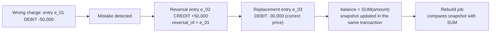

# Core Billing — Append-only Ledger and the Correction Model

Date: 2026-11-09 · Scope: confirming "the Ledger is the financial source of truth, append-only" and defining how mistakes are corrected · Status: advisory, no code written.

## Confirmed reframing

**Problem.** The specification says only that every balance change is recorded in the Ledger and that Ledger history is "never edited directly". It does not define the entry model, how balances stay in sync with entries, or what a correction looks like. Without those, an implementation will either open an UPDATE path or promote a mutable balance row to a second source of truth. The principle is right; the missing part is the pair (immutable entries + derived balance) and the enforcement that makes both facts mechanical.

**Project owner's decisions**

| Topic | Choice |
|---|---|
| Source of truth | The Ledger. Entries are immutable and only ever inserted |
| Correction model | Reversal entry referencing the original, plus a replacement entry when needed. No in-place edits, no deletes |
| Balance | Derived from entries, with a snapshot updated in the same transaction and a rebuild/verify job |
| Entry model | Single-entry per wallet (each entry belongs to exactly one wallet); no double-entry bookkeeping |
| Holds | Reservation holds budget outside the Ledger; entries are posted only when a capture or charge actually moves money |
| Currency | Each wallet supports exactly one currency; multi-currency means multiple wallets per customer; currency is immutable on a wallet |
| Transfers | No cross-currency or inter-wallet transfer feature at this stage |

**Exact requirements**

1. No use case, API or adapter may update or delete a Ledger entry. The repository is insert-and-read only.
2. Every balance change is exactly one new entry, written in the same transaction as the wallet snapshot, reservation state and outbox row.
3. A correction is a reversal entry that references the original (`reversal_of`) and negates it; if the correct amount differs, a new entry is posted after the reversal.
4. A reversal requires an actor and a reason, and must target the same wallet and currency as the original.
5. A balance is `SUM(amount)` for a wallet; available balance is the balance minus held amounts. The wallet snapshot is a projection, not the source of truth.
6. Idempotency is enforced by a database unique constraint, not by a read-then-write check in application code.
7. Wallet identity includes currency: unique `(tenant, customer, currency)`, immutable once created. A composite foreign key on `(wallet_id, currency)` makes a cross-currency entry impossible to insert.
8. Entries are ordered by a monotonic sequence, not by `posted_at`, so audit replay is deterministic.
9. Immutability is enforced mechanically: the application's database role has INSERT/SELECT only, a trigger rejects UPDATE/DELETE, and architecture tests reject any update/delete method on the ledger repository.

**Goals.** Complete auditability, deterministic replay, dispute traceability, a balance that cannot silently drift from the entries, and no code path that rewrites financial history.

**Done means**

- `grep` finds no UPDATE/DELETE path for the Ledger table, and the database rejects UPDATE/DELETE issued by the application role.
- An integration test posts a wrong charge, reverses it, then posts the correct charge; the ledger holds three linked entries and the balance equals the expected amount.
- Retrying the same request produces exactly one entry.
- The rebuild job recomputes balances from entries and matches the snapshot rows with zero mismatches.
- Posting an entry with the wrong currency for a wallet fails at the database constraint.

**Non-goals.** Double-entry bookkeeping, event sourcing across the system, in-place edits, inter-wallet or cross-currency transfers, FX handling.

**Constraints.** Spring Data JDBC; plain-Java `domain` and `application`; the transaction boundary is the application-owned `UnitOfWork`; the `money` module commits wallet, ledger, reservation and outbox in one ACID transaction.

## Preview of the target state



| id | type | amount | ref | reversal_of | reason |
|---|---|---|---|---|---|
| e_01 | DEBIT | -50,000 | charge:ch_999 | — | — |
| e_02 | REVERSAL | +50,000 | reversal:ch_999 | e_01 | wrong_price |
| e_03 | DEBIT | -30,000 | charge:ch_999b | — | — |

The Ledger only receives INSERTs. No screen or endpoint exposes edit or delete.

## Verdict

The principle is correct, and for a billing system with audit obligations it is not ceremony. But "append-only" alone is not a design: the correctness comes from the pair (immutable entries + derived balance + mechanical enforcement). The risk is not the principle; it is the three seams — holds, corrections, and the balance projection drifting from the entries. The current documentation states the principle without the mechanism, which is exactly where implementations rot.

## What you should do

1. **Define the entry model in the domain before writing the adapter.** An immutable `LedgerEntry` with wallet, currency, type, amount, reference, idempotency key, sequence, reversal link, actor and reason. Only factory methods can create a posting or a reversal; there are no setters.
2. **Keep holds out of postings.** The reservation owns the held amount; the Ledger posts only on capture or charge. Writing HOLD/RELEASE rows into the Ledger breaks the meaning of `SUM(amount)`.
3. **Treat balance as a projection.** A `(wallet_id)` keyed balance row with a `last_sequence`, updated inside the same `UnitOfWork` transaction as the entry and the outbox row. A rebuild/verify job recomputes from entries and alerts on mismatch.
4. **Correct with whole-entry reversals.** Negate the original amount, link it through `reversal_of`, require an actor and a reason, and keep the same wallet and currency. If only part of the amount is wrong, reverse the whole entry and post replacement entries — never mutate half an entry.
5. **Let the database enforce idempotency.** A unique index over `(tenant_id, reference_type, reference_id, entry_kind)` (or an idempotency key) is the enforcement; the application check is only an optimization.
6. **Enforce immutability mechanically.** The application role gets INSERT/SELECT only on the ledger table, a trigger rejects UPDATE/DELETE, the repository interface exposes only append and find, and an architecture test rejects update/delete methods.
7. **Order by sequence.** A monotonic sequence per tenant (or global) makes audit replay deterministic; `posted_at` alone suffers clock skew and duplicate millisecond timestamps.
8. **Make the transaction explicit.** The `UnitOfWork` port owned by the application wraps entry insert, snapshot update, reservation state and outbox append, as the architecture already requires.

## What you shouldn't do

- **Don't make the balance row the source of truth** and treat the Ledger as a secondary log. That is the fastest way to two divergent sources and a broken audit trail.
- **Don't build an "edit entry" or "void entry" endpoint** under any name, including for Platform Administration. Corrections are new entries.
- **Don't use a soft-delete or `is_void` flag on entries** as a substitute for reversal; it breaks append-only and forces every balance query to filter.
- **Don't write HOLD/RELEASE rows into the Ledger** just because the specification lists four operations. That list describes business capabilities, not entry types.
- **Don't adopt double-entry bookkeeping now.** There are no revenue or clearing accounts and no two-sided requirement yet. It is a seam to open later, not today's work.
- **Don't enforce immutability only through code review or convention.**
- **Don't use `occurred_at` or `posted_at` as the audit ordering key.**
- **Don't introduce event sourcing or full-system replay** to "match" the append-only Store.

## What could be better / more efficient

- **Add periodic checkpoints** next to the snapshot so a rebuild only sums entries since the last checkpoint instead of scanning the entire history.
- **Partition the ledger table by tenant or month** from the start; it costs almost nothing in the schema and avoids pain when history grows and retention deletes.
- **Run the Stripe reconciliation in the same job as the balance rebuild** so there is one external source of truth to compare against instead of two pipelines.
- **Expose a single append-only repository interface** so the constraint is expressed in the type system rather than in a reminder.

## My take and how to get there

Lock the design into a contract before writing code: (1) record the entry model, invariants, reversal model, projection and enforcement in `docs/wallet-ledger-and-charging.md`, replacing the bare "never edited directly" sentence; (2) define `Money`, `EntryType`, `LedgerEntry` and the wallet balance projection in `domain`; (3) add the insert-only `LedgerRepository` port and `UnitOfWork`; (4) create the migration with the idempotency unique index, sequence, database privileges and trigger; (5) implement `PostEntry` and `ReverseEntry` use cases; (6) add the rebuild job and its matching test; (7) add the architecture rule that rejects update/delete. Keep the same order for the wallet/currency decision: wallet identity first, then entries, then use cases.

**Extensibility check.** The credible next extension is multi-currency at the customer level, and it is already covered by making the wallet's currency part of its identity: adding a currency creates a new wallet and touches no ledger code. A cross-currency transfer, if it ever arrives, is a new use case that posts two entries inside one transaction; the entry model does not change. A double-entry conversion would require rewriting the entry schema and backfilling, which is why the current entry model should stay clean — but building account balances and journal lines now would cost more than it returns. Recommend the single-entry model with the currency seam, and do not build FI/FX infrastructure until a second real requirement exists.

## Benefits

- Full audit and dispute traceability: every balance change has a source and a linked reversal.
- Balance cannot drift from the Ledger without the verify job reporting it.
- Retry and replay are safe because idempotency lives in the database.
- Corrections are accountable: actor and reason are mandatory; no silent "someone changed the number".
- A clean foundation to open double-entry later if accounting requirements appear.

## Trade-offs

- Every correction costs at least two entries instead of one UPDATE, so the ledger grows faster.
- The rebuild/verify job and its mismatch metric are real operational costs.
- The read path is more complex: a projection is required and "the balance can be rebuilt" must be accepted.
- Operational correction is heavier: support cannot "fix a number quickly" and must understand reversal.
- This model **stops being right** if the product does not need audit or reconciliation (for example, an internal demo wallet), where a mutable snapshot is enough. That does not apply to Core Billing.
- If full accounting revenue reporting is later required, moving to double-entry means rewriting the entry schema and backfilling.
- A wallet per currency means a customer with N currencies has N independent balances and invoices must not mix them.

## Unverified

- The specification does not define the entry schema, sequence or immutability mechanism; these are inferred from `docs/wallet-ledger-and-charging.md` and `docs/architecture.md`, with no code to verify yet. Confirmation comes when the `money` module migration and repository interface are reviewed.
- No regulatory or accounting requirement demanding double-entry has been confirmed.
- No documentation validator or build exists in the repository yet, so "build red" is currently a local expectation, not a verified gate.

## Work checklist

- [ ] Update `docs/wallet-ledger-and-charging.md` with the entry model, invariants, reversal model, projection and enforcement.
- [ ] `domain`: `Money`, `EntryType`, immutable `LedgerEntry` (factories `post` and `reverseOf`), wallet balance projection type.
- [ ] `application`: insert-only `LedgerRepository` port and `UnitOfWork`.
- [ ] Migration: `ledger_entry` table, idempotency unique index, sequence, index on `(wallet_id, sequence)`.
- [ ] Database privileges (INSERT/SELECT only) plus an UPDATE/DELETE trigger.
- [ ] `PostEntry` use case: entry insert, snapshot update and outbox append in one transaction.
- [ ] `ReverseEntry` use case: reversal linked to the original, requiring actor and reason.
- [ ] Rebuild/verify job plus a mismatch metric.
- [ ] Architecture test rejecting update/delete on the ledger repository.
- [ ] Integration tests: wrong charge → reversal → correct balance; retry → one entry; rebuild matches snapshot; wrong-currency insert rejected.

## Success metrics

- UPDATE/DELETE on `ledger_entry` by the application role fails on permission (verified by a database test).
- Mismatches between `SUM(amount)` and the snapshot equal zero after every verify run.
- N retries of the same request produce exactly one entry.
- Every reversal has `reversal_of` pointing at an existing entry, and each reversal plus its original sums to zero.
- An entry with a currency different from its wallet is rejected by the database constraint.

## Handoff brief

```text
Objective: Confirm and scaffold the append-only ledger model (single-entry per wallet, balance as a projection with a verify job, corrections only through reversal entries) for the money module.

Done means:
- docs/wallet-ledger-and-charging.md describes the entry model, invariants, reversal model, projection and enforcement.
- LedgerEntry is immutable in the domain, the repository exposes append/find only, and an architecture test rejects update/delete.
- The migration adds the idempotency unique index, sequence, and a trigger that rejects UPDATE/DELETE; the application role has INSERT/SELECT only.
- PostEntry and ReverseEntry run inside UnitOfWork and write the outbox row in the same transaction.
- A rebuild/verify job recomputes balances and reports mismatches; integration tests cover wrong charge -> reversal, retry, rebuild and wrong-currency insert.

Out of scope: double-entry bookkeeping, event sourcing across the system, in-place edits, inter-wallet or cross-currency transfers, FX, payment and invoice flows.

Constraints: Spring Data JDBC; plain-Java domain/application (no Spring/JPA/Jackson); transaction through the application-owned UnitOfWork port; money module commits one ACID transaction including the outbox.

Stop and ask only if: an accounting or regulatory requirement forces double-entry, or a real need for inter-wallet transfers appears and changes the confirmed entry model.
```
